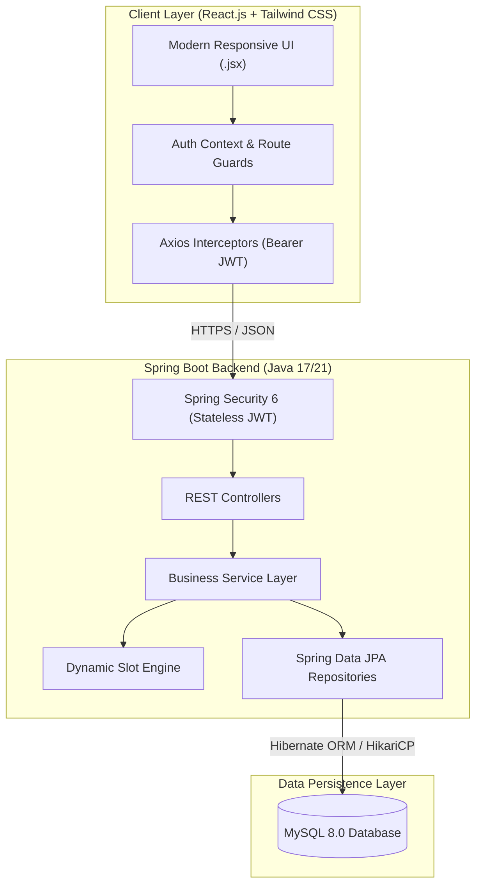
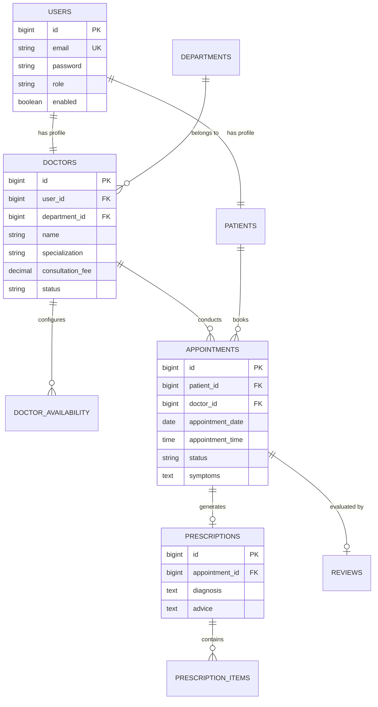

<div align="center">

# 🏥 CareConnect
### *Next-Generation Hospital & Clinical Appointment Ecosystem*

[](LICENSE.md)
[](https://www.oracle.com/java/)
[](https://spring.io/projects/spring-boot)
[](https://react.dev/)
[](https://tailwindcss.com/)
[](https://www.mysql.com/)
[](https://jwt.io/)

<br />

**A state-of-the-art healthcare web platform connecting Patients, Doctors, and Administrators with real-time consultation scheduling, electronic prescriptions, and clinical governance.**

<br />

[Explore Master Architecture Plan ➔](./plan.md) · [Report Bug](https://github.com/SushreeSonitaBiswal/Mern_Project/issues) · [Request Feature](https://github.com/SushreeSonitaBiswal/Mern_Project/issues)

</div>

---

## 🧭 Table of Contents

- [✨ Key Highlights](#-key-highlights)
- [👥 Role-Based Experience](#-role-based-experience)
  - [👤 Patient Experience](#-patient-experience)
  - [👨‍⚕️ Doctor Consultation Suite](#️-doctor-consultation-suite)
  - [👨‍💼 Administrative Command Center](#-administrative-command-center)
- [🏛️ System Architecture](#️-system-architecture)
- [💻 Tech Stack Breakdown](#-tech-stack-breakdown)
- [📊 Database Architecture & ERD](#-database-architecture--erd)
- [📂 Clean Project Hierarchy](#-clean-project-hierarchy)
- [🔌 REST API Matrix](#-rest-api-matrix)
- [⚡ Quick Start Guide](#-quick-start-guide)
- [🔑 Seed Accounts & Credentials](#-seed-accounts--credentials)
- [📜 License](#-license)

---

## ✨ Key Highlights

- ⏱️ **Intelligent Slot Engine**: Dynamically calculates open 30-minute consultation windows based on weekly schedules, breaks, and booked slots.
- 🔐 **Zero-Trust Security**: Spring Security 6 with stateless JWT Bearer token authentication and strict role-based access control (`ROLE_PATIENT`, `ROLE_DOCTOR`, `ROLE_ADMIN`).
- 💊 **Digital Prescription Studio**: Structured prescription creator with medicine dosages, intake frequencies, durations, and clinical notes.
- 📈 **Hospital Analytics Board**: Live metrics tracking consultation volumes, verified staff, and active patients.
- 🎨 **Modern Aesthetic Interface**: Designed with Tailwind CSS featuring harmonious medical palettes (Emerald, Cyan, Indigo, Slate), responsive card layouts, and micro-interactions.

---

## 👥 Role-Based Experience

<table>
<tr>
<td width="33%" valign="top">

### 👤 Patient Portal
* 🔍 **Smart Doctor Discovery**: Filter by department, experience, rating, and fee.
* 📅 **Live Slot Picker**: Book 30-min slots with instant collision checks.
* 📋 **Appointment Timeline**: Monitor bookings from *Requested* to *Completed*.
* 💊 **Prescription Vault**: Review and download doctor advice anytime.
* ⭐ **Doctor Ratings**: Leave feedback and 5-star ratings for care received.

</td>
<td width="33%" valign="top">

### 👨‍⚕️ Doctor Portal
* 🗓️ **Custom Availability**: Setup working days, consultation hours, and breaks.
* 📥 **Consultation Queue**: Review requests, confirm slots, or reject with reason.
* 🩺 **Consultation Studio**: Inspect patient medical details and symptoms.
* ✍️ **Rx Prescription Composer**: Multi-row medication writer with auto dosages.
* 📊 **Performance Insights**: Track completed consultations and patient feedback.

</td>
<td width="33%" valign="top">

### 👨‍💼 Admin Console
* 📊 **Executive Overview**: Total patients, verified doctors, and active appointments.
* 🛡️ **Doctor Verification**: Review credentials and approve or suspend practitioners.
* 🏥 **Department Registry**: Create and manage hospital departments.
* 🔎 **Global Audit Ledger**: Search, filter, and inspect every appointment system-wide.
* ⚙️ **Platform Controls**: System settings and security policy audits.

</td>
</tr>
</table>

---

## 🏛️ System Architecture



---

## 💻 Tech Stack Breakdown

<div align="center">

| Technology | Purpose | Documentation |
| :--- | :--- | :--- |
| **Java 17 / 21** | Modern, performant backend programming runtime | [Java Docs](https://dev.java/) |
| **Spring Boot 3** | Enterprise REST micro-framework & Dependency Injection | [Spring Boot](https://spring.io/projects/spring-boot) |
| **Spring Security & JWT** | Role-based authorization & stateless tokens | [Spring Security](https://spring.io/projects/spring-security) |
| **Hibernate & JPA** | Object-Relational Mapping & query optimization | [Hibernate](https://hibernate.org/) |
| **MySQL 8.0** | ACID-compliant relational persistence store | [MySQL](https://www.mysql.com/) |
| **React 18** | High-performance interactive UI component tree (`.jsx`) | [React](https://react.dev/) |
| **Tailwind CSS** | Premium utility-first styling with modern glassmorphism | [Tailwind](https://tailwindcss.com/) |
| **Axios** | Promised-based HTTP client with request/response interceptors | [Axios](https://axios-http.com/) |

</div>

---

## 📊 Database Architecture & ERD



---

## 📂 Clean Project Hierarchy

```text
careconnect/
├── README.md                      # 📖 Modern project presentation
├── plan.md                        # 📐 Comprehensive 8-phase master plan
├── LICENSE.md                     # ⚖️ MIT open source license
│
├── backend/                       # ☕ Spring Boot Application
│   ├── pom.xml
│   └── src/main/java/com/careconnect/
│       ├── controller/            # REST API Controllers (Auth, Doctor, Patient, etc.)
│       ├── service/               # Domain Business Logic & Slot Algorithms
│       ├── repository/            # Spring Data JPA Repository Layer
│       ├── entity/                # Relational JPA Data Entities
│       ├── dto/                   # Request / Response Transfer Objects
│       ├── security/              # JWT Filters, UserDetailsService & Config
│       └── exception/             # Centralized RestControllerAdvice Handlers
│
└── frontend/                      # ⚛️ React.js + Tailwind CSS (.jsx)
    ├── package.json
    ├── tailwind.config.js
    └── src/
        ├── components/            # Atomic Reusable Components (Modals, Badges, Pickers)
        ├── pages/                 # Public, Patient, Doctor, and Admin views
        ├── context/               # AuthContext & Global Session State
        ├── services/              # Clean API Client Modules
        └── routes/                # Protected Routes & RBAC Guards
```

---

## 🔌 REST API Matrix

### 🔐 Authentication & Session
| Method | Endpoint | Access | Description |
| :--- | :--- | :--- | :--- |
| `POST` | `/api/auth/register` | Public | Register new patient account |
| `POST` | `/api/auth/login` | Public | Authenticate user & get JWT token |
| `GET` | `/api/auth/me` | Authenticated | Fetch current user session details |

### 🩺 Doctors & Scheduling
| Method | Endpoint | Access | Description |
| :--- | :--- | :--- | :--- |
| `GET` | `/api/doctors` | Public | Paginated doctor search with filter query |
| `GET` | `/api/doctors/{id}` | Public | Detailed doctor portfolio & reviews |
| `GET` | `/api/doctors/{id}/slots` | Public | Calculate real-time available slots for date |
| `POST` | `/api/doctor/availability` | Doctor | Update weekly consultation time windows |

### 📅 Appointments & Consultations
| Method | Endpoint | Access | Description |
| :--- | :--- | :--- | :--- |
| `POST` | `/api/patient/appointments` | Patient | Reserve time slot & submit symptoms |
| `GET` | `/api/patient/appointments` | Patient | List patient's appointment records |
| `PATCH` | `/api/patient/appointments/{id}/cancel` | Patient | Cancel pending appointment |
| `PATCH` | `/api/doctor/appointments/{id}/status` | Doctor | Transition status (`CONFIRMED`, `COMPLETED`, `REJECTED`) |

### 💊 Prescriptions & Feedback
| Method | Endpoint | Access | Description |
| :--- | :--- | :--- | :--- |
| `POST` | `/api/prescriptions` | Doctor | Generate consultation diagnosis & medicines |
| `GET` | `/api/prescriptions/{appointmentId}` | Patient/Doctor | Read structured consultation prescription |
| `POST` | `/api/patient/reviews` | Patient | Submit rating and feedback for completed visit |

### 🛡️ Administration
| Method | Endpoint | Access | Description |
| :--- | :--- | :--- | :--- |
| `GET` | `/api/admin/stats` | Admin | Aggregate hospital metrics & counters |
| `PATCH` | `/api/admin/doctors/{id}/status` | Admin | Approve, reject, or suspend doctor credentials |

---

## 🔄 Dual Database Support: PostgreSQL vs. MySQL

CareConnect is architected on **Spring Data JPA & Hibernate**, making it completely database-agnostic. All entities, relationships, and queries use standard JPA/JPQL.

### Current Active Database:
- **PostgreSQL (Supabase Cloud)** is pre-configured and active by default. No local database installation is needed to run the project.

---

### 🔀 How to Switch to MySQL (in 2 Steps):

If you or your team wish to run CareConnect on **MySQL** (local or server), follow these simple steps:

#### **Step 1: Switch Driver in [`backend/pom.xml`](backend/pom.xml)**
Comment out PostgreSQL and uncomment MySQL:
```xml
<!-- 1. Comment out PostgreSQL -->
<!--
<dependency>
    <groupId>org.postgresql</groupId>
    <artifactId>postgresql</artifactId>
    <scope>runtime</scope>
</dependency>
-->

<!-- 2. Uncomment MySQL -->
<dependency>
    <groupId>com.mysql</groupId>
    <artifactId>mysql-connector-j</artifactId>
    <scope>runtime</scope>
</dependency>
```

#### **Step 2: Switch Credentials in [`backend/src/main/resources/application.properties`](backend/src/main/resources/application.properties)**
Comment out the PostgreSQL block and uncomment the MySQL block:
```properties
# 1. Comment out PostgreSQL properties:
# spring.datasource.url=jdbc:postgresql://...
# spring.datasource.username=...
# spring.datasource.password=...
# spring.datasource.driver-class-name=org.postgresql.Driver
# spring.jpa.database-platform=org.hibernate.dialect.PostgreSQLDialect

# 2. Uncomment MySQL properties:
spring.datasource.url=jdbc:mysql://localhost:3306/careconnect_db?createDatabaseIfNotExist=true&useSSL=false&allowPublicKeyRetrieval=true&serverTimezone=UTC
spring.datasource.username=root
spring.datasource.password=your_mysql_password
spring.datasource.driver-class-name=com.mysql.cj.jdbc.Driver
spring.jpa.database-platform=org.hibernate.dialect.MySQLDialect
```

Hibernate will automatically create all tables (`ddl-auto=update`) in your MySQL database on startup!

---

## ⚡ Quick Start Guide

### 1. Database Setup
```sql
CREATE DATABASE careconnect_db CHARACTER SET utf8mb4 COLLATE utf8mb4_unicode_ci;
```

### 2. Backend Initialization
```bash
cd backend
# Update src/main/resources/application.properties with your MySQL credentials
./mvnw clean spring-boot:run
```
> The API server will be live at `http://localhost:8080`.

### 3. Frontend Initialization
```bash
cd frontend
npm install
npm run dev
```
> The React client will be accessible at `http://localhost:5173`.

---

## 🔑 Seed Accounts & Credentials

| Role | Email Address | Password | Permissions |
| :--- | :--- | :--- | :--- |
| 👑 **System Admin** | `admin@careconnect.com` | `Admin@123` | Full administrative control |
| 👨‍⚕️ **Senior Cardiologist** | `raj.kumar@careconnect.com` | `Doctor@123` | Doctor consultation & schedule |
| 👤 **Patient User** | `rahul.sharma@careconnect.com` | `Patient@123` | Slot booking & medical profile |

---

## 📜 License

Distributed under the **MIT License**. See the [`LICENSE.md`](./LICENSE.md) file for complete details.

<div align="center">
  <sub>Built with ❤️ for Modern Healthcare Engineering</sub>
</div>
